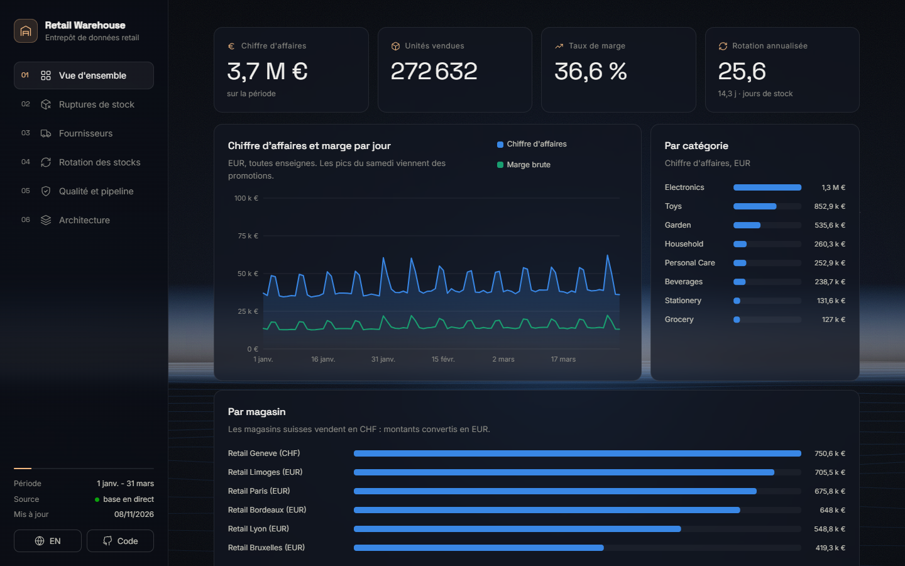
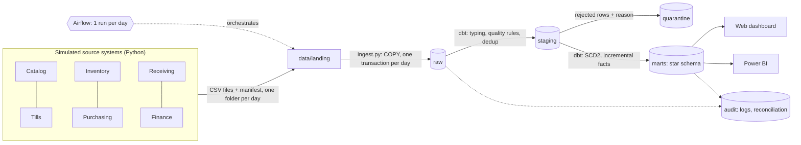
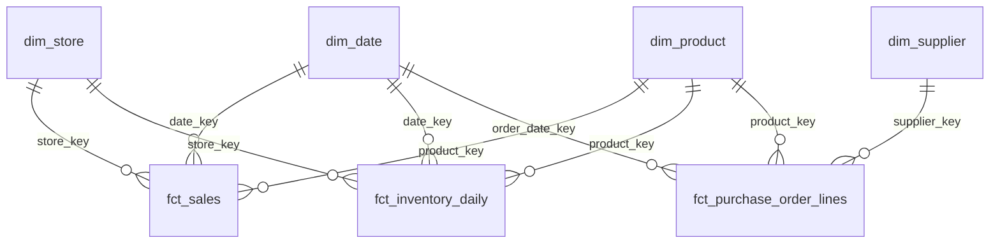
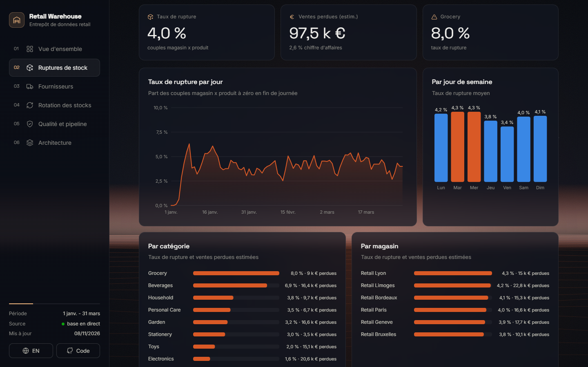

# Retail Inventory and Supply Chain Data Warehouse

[](README.md) [](README.en.md)

[](https://github.com/cheugs/Retail-Inventory-or-and-Supply-Chain-Warehouse/actions/workflows/ci.yml)       

Student data engineering project: a **star-schema data warehouse** that brings together **supplier
orders**, the **product catalog**, **deliveries**, **inventory** and **sales** of a simulated store chain,
to answer three questions: **where is stock missing**, **which suppliers keep their promises**, and
**how fast does the stock turn over**.

> All data is **synthetic**: the company, stores, products and suppliers are invented. The project
> shows a data engineering approach; it does not claim to describe a real company.

**Online demo:** the dashboard is published for free as a static site (see
[docs/en/DEPLOYMENT.md](docs/en/DEPLOYMENT.md)). The full chain runs locally with Docker (section 13).

**Author:** Chengho Fongang Marie Louise

> The French README ([README.md](README.md)) is the main version; this is the English translation.



**Contents:**
[1. Overview](#1-project-overview) ·
[2. Context](#2-business-context-and-mission) ·
[3. Objectives](#3-project-objectives) ·
[4. Architecture](#4-system-architecture) ·
[5. Data model](#5-data-model-and-source-schema) ·
[6. Challenges](#6-engineering-challenges-and-solutions) ·
[7. Processing](#7-data-processing-and-business-logic) ·
[8. Decisions](#8-engineering-decisions-and-trade-offs) ·
[9. Results](#9-results-and-performance-benchmarks) ·
[10. Dashboard](#10-dashboard-and-monitoring) ·
[11. Testing](#11-testing-and-reliability) ·
[12. Stack](#12-technology-stack) ·
[13. Installation](#13-installation-and-execution) ·
[14. Limitations](#14-limitations-and-future-improvements) ·
[15. Skills](#15-skills-demonstrated)

---

## 1. Project overview

A Python script simulates the systems of a small chain of **6 stores** (France, Belgium and Switzerland,
so two currencies: EUR and CHF), **150 products** and **12 suppliers** over **90 days**. Every day, these
"source systems" drop their files: till sales, end-of-day stock counts, supplier orders, goods
receipts, catalog changes, exchange rates, and a **manifest** with control totals.

**Airflow** loads these files into PostgreSQL every day (`raw` layer), runs **dbt** which cleans, checks
and transforms the data into a **star schema** (3 fact tables, 4 dimensions including one **SCD type 2**),
runs the tests, then **reconciles** the warehouse with the source totals. A web dashboard presents
stockouts, supplier performance and inventory turnover.

**In short:**
- **Start:** `docker compose up -d --build` (or `python -m retail_pipeline.run all` without Airflow)
- **What it shows:** dimensional modeling, slowly changing dimensions (SCD 1 and 2), incremental
  transformations, late and early-arriving records, isolation of invalid data, deduplication,
  reconciliation against source totals, replay of history
- **Demo volume:** about 161,000 raw sales lines, 77,000 stock counts, 4,500 order lines
- **Tested:** 17 unit tests, 17 integration and end-to-end tests, 48 dbt tests, 14 reconciliation checks, GitHub Actions CI
- **Checklist:** every acceptance item is linked to its proof in [docs/en/CHECKLIST.md](docs/en/CHECKLIST.md)

## 2. Business context and mission

In a retail chain, useful data is scattered: the till knows the sales, the stock system knows what is on
the shelf, purchasing knows the orders, the warehouse knows the receipts, and the catalog changes prices
along the way. To understand **why a shelf is empty**, all of this has to be combined.

This data is also imperfect: a till sends a file twice, a sale arrives two days later, a new product is
sold before it appears in the catalog, a price change is sent late, a column appears in a file.

**Mission:** build a **reliable** warehouse where every figure can be explained: each sale is counted
once, on the right date, with the price and cost valid at that time; invalid rows are set aside with
their reason; and warehouse totals are reconciled with source totals.

## 3. Project objectives

1. Simulate realistic sources, with deliberate quality problems.
2. Load files **idempotently** (re-running a day creates no duplicate) and **atomically** (a whole day or nothing).
3. Build a **star schema**: sales, inventory and purchase order facts; product, store, supplier and date dimensions.
4. Keep the product catalog history as **SCD type 2** (price, cost, supplier), stores and suppliers as **SCD type 1**.
5. Handle **late-arriving data** and **facts that arrive before their dimension**.
6. **Reconcile** the warehouse with the source control totals and prove nothing is lost.
7. Produce three analyses: **stockouts**, **supplier performance**, **inventory turnover**.
8. Orchestrate with **Airflow**, test automatically, measure performance up to **1 million** rows.

## 4. System architecture



| Component | Role |
|---|---|
| `retail_pipeline/generate.py` | Simulates the business day by day and writes the source system files |
| `retail_pipeline/ingest.py` | Loads one day of files into `raw` (COPY), checks the schema, stores the manifest |
| `dbt/` | Transforms `raw` into `staging`, `quarantine` and `marts`; holds the data tests |
| `retail_pipeline/reconcile.py` | Compares the warehouse with source totals, writes `audit.reconciliation` |
| `airflow/dags/retail_warehouse_daily.py` | Daily orchestration with automatic retries |
| `dashboard/` | FastAPI API (live data) and static site (data exported to JSON) |
| `benchmarks/run_benchmark.py` | Measures run times on 10,000, 100,000 and 1,000,000 sales lines |

**PostgreSQL schemas:** `raw` (raw text, as received) · `staging` (typed and checked) · `quarantine`
(rejected rows with reason) · `marts` (star schema and analyses) · `audit` (load log, pipeline steps,
reconciliation).

## 5. Data model and source schema

### Star schema



| Table | Type | Grain (one row =) | Load |
|---|---|---|---|
| `fct_sales` | Transaction fact | one till receipt line | incremental (`delete+insert` on `sale_line_id`) |
| `fct_inventory_daily` | Periodic snapshot fact | one store x one product x one day | incremental |
| `fct_purchase_order_lines` | Accumulating snapshot fact | one supplier order line (ordered, promised, delivered) | rebuilt every run |
| `dim_product` | SCD type 2 dimension | one **version** of a product (`valid_from`, `valid_to`, `is_current`) | rebuilt from full history |
| `dim_store`, `dim_supplier` | SCD type 1 dimensions | one store, one supplier (values overwritten) | rebuilt |
| `dim_date` | Calendar | one day | generated |

Analysis tables (`marts`): `mart_daily_sales`, `mart_stockouts_daily`, `mart_supplier_performance_monthly`,
`mart_inventory_turnover_monthly`, `mart_product_inventory_health`, `mart_anomaly_indicators`.

### Source files (one folder per day)

| File | Content | Deliberate problems |
|---|---|---|
| `sales.csv` | `sale_line_id, receipt_id, store_id, product_id, sold_at, quantity, unit_price, discount_amount, currency` (+ `channel` from day 45, + `loyalty_card` from day 60) | 2% late by 1-2 days, 0.5% duplicates, 0.3% invalid values, new columns |
| `inventory.csv` | end-of-day stock per store and product | one store's file sometimes delivered one day late |
| `products.csv` | catalog changes (`updated_at`) | new products sent one day after their first sales, price changes sent 2 days late |
| `purchase_orders.csv`, `deliveries.csv` | orders and receipts | late, partial and split deliveries, negative quantities |
| `stores.csv`, `suppliers.csv`, `fx_rates.csv` | master data and EUR/CHF rates | store manager and supplier name changes (SCD 1) |
| `_manifest.json` | row count and control sums per file | used for reconciliation |

## 6. Engineering challenges and solutions

| Challenge | Solution |
|---|---|
| **A malformed value must not break the load** | The `raw` layer stores everything as text. Typing happens in dbt with a `try_cast` macro (`pg_input_is_valid` on PostgreSQL 16, `try_cast` on Snowflake) that returns NULL instead of failing. |
| **Isolate invalid rows without losing anything** | Each `stg_*_checked` model computes a `rejection_reason`. Valid rows go to the facts, others to `quarantine.*` with their reason. A test checks raw = facts + quarantine. |
| **Duplicates** (same line sent twice) | `row_number()` per business id over every received row: only the first occurrence is kept, the others go to quarantine (`duplicate_sale_line_id`). |
| **Late sales** | Incremental facts process rows loaded since the last run (`_loaded_at`), whatever their sale date: a Monday sale received on Wednesday is placed on Monday. |
| **Sales of a product not yet in the catalog** (early-arriving fact) | The sale points to the "unknown product" member (`product_key = '-1'`) and is re-processed at every run until the product arrives. |
| **Price change sent late** | The SCD2 history is rebuilt from every catalog row, sorted by `updated_at`; sales of products changed since the last run are re-processed to point to the right version. |
| **Re-running a day or recovering from a crash** | One day = one transaction: delete then insert the batch. A crash in the middle cancels the whole batch; the retry loads it fully. |
| **New columns in the files** | Missing optional column = NULL; unknown column ignored and logged in `audit.load_log`; missing mandatory column = stop with a clear error. |
| **Two currencies** | Amounts converted to EUR with the rate of the sale day. |

## 7. Data processing and business logic

**Stockouts.** A product is out of stock in a store when its end-of-day stock is 0. Stockout rate =
store x product days at 0 / all store x product days. **Lost sales** are an estimate: for each stockout
day, the product's average daily sales in that store on the days it was available.

**Supplier performance.** Each order line keeps its milestones: order date, promised date, first and last
delivery, quantities ordered and received.
- *On time*: first delivery on or before the promised date.
- *In full*: quantity received >= quantity ordered.
- *OTIF* (On Time In Full): both, with the last delivery on or before the promised date.
- *Fill rate*: units received / units ordered.
- Only **evaluable** lines are counted (already delivered or past their promised date), so a supplier is
  not penalised for an order that is not due yet.

**Inventory turnover.** Turnover = cost of goods sold / average stock value, both **at cost** (the cost
valid at the time of the sale, thanks to SCD2). It is **annualized** (x 365 / number of days) to compare
periods of different length. Days of inventory = number of days / turnover.

**Simulated anomaly indicators.** Two simple rules, written in the `rule` column: unexplained stock drop
(stock < previous stock + received - sold - 2) and till price more than 40% away from the catalog price.
These are **leads to check**, not proof of theft or fraud.

**Reconciliation** (`reconcile.py`, 14 checks stored in `audit.reconciliation`):
1. *Completeness*: rows and sums in `raw` = rows and sums in the manifest, for each day and file.
2. *Conservation*: raw rows and units = facts + quarantine (nothing disappears, nothing is counted twice).
3. *Aggregation*: revenue in `mart_daily_sales` = revenue in `fct_sales`.

If a check fails, the step raises an error and the Airflow task turns red.

## 8. Engineering decisions and trade-offs

| Decision | Why | Trade-off |
|---|---|---|
| **PostgreSQL** as local warehouse, **Snowflake** as optional target | Free, reproducible with Docker; models only use cross-database macros (`adapter.dispatch`) | The Snowflake target is configured (`profiles.yml`) but not tested in CI (needs a paid account) |
| SCD2 **rebuilt in SQL** from the full history rather than a `dbt snapshot` | The result does not depend on the order or date of runs: a late change lands in the right place, and a full replay gives the same result | The full catalog history must be kept in `raw` (small volume here) |
| Facts in **`delete+insert`** on the business key | Works on PostgreSQL and Snowflake; a re-run replaces rows instead of doubling them | Slightly slower than a plain append |
| `raw` layer **as text** | No value can break the load; the raw row stays visible in quarantine | Typing happens later, in dbt |
| One day = **one transaction** | No half-loaded day | A very big day keeps the transaction open longer |
| Order facts **rebuilt** every run | An accumulating snapshot changes with every delivery; rebuilding is simple and safe | Would become expensive with millions of orders |
| PostgreSQL with **`wal_level=minimal`** | Tables rebuilt by dbt no longer go through the WAL: `dbt build` 6 times faster (section 9) | No replication or point-in-time restore |
| Dashboard as **static site + JSON** for the online demo | Free hosting that never sleeps, no database exposed to the Internet | Online figures are those of the last export |

**Delivery guarantees.** Loading is "at least once" (a day can be re-run), but the **result** is
"exactly once": delete then insert per batch in `raw`, deduplication by id in `staging`, `delete+insert`
on the key in the facts. This is tested (`test_reloading_a_day_is_idempotent`,
`test_duplicates_do_not_inflate_amounts`, `test_crash_during_a_batch_rolls_back_everything`).

## 9. Results and performance benchmarks

### Business results (demo dataset, 90 days)

| Indicator | Value |
|---|---|
| Revenue | EUR 3.75 M, gross margin 36.6% |
| Stockout rate | 4.0% of store x product days; estimated lost sales EUR 97,500 (2.6% of revenue) |
| Most affected categories | Grocery (8.0%) and Beverages (6.9%): low safety stock and high demand |
| Supplier OTIF | 65.7% on average, from 47.4% (SUP09) to 91.3% (SUP07); fill rate 96.4% |
| Annualized turnover | 25.6, i.e. 14.3 days of inventory; from 5.7 days (Beverages) to 17.4 days (Electronics) |

Reading them together is interesting: the fastest-turning categories are also the ones most often out
of stock. Late suppliers (SUP09, SUP12, SUP05) feed the stockouts.

### Data quality (demo dataset)

| Check | Result |
|---|---|
| Rows isolated in quarantine | 1,237 (777 duplicates), all with their reason |
| Late-arriving sales | 3,134 rows, all placed on their real date |
| Sales received before their product | 44 rows on 5 products, all linked later (0 left as "unknown") |
| Product versions (SCD2) | 22 new versions (price or supplier changes) |
| Reconciliation | 14 checks out of 14 passed |

### Performance

Measured with `python -m benchmarks.run_benchmark` (empty database, generation, load of every day,
full `dbt build` with the 48 tests, reconciliation). Windows 11 laptop, 12 threads, PostgreSQL 16 in
Docker Desktop. Details: [benchmarks/results.md](benchmarks/results.md).

| Size | Sales lines | Source rows (all files) | Ingestion | dbt build | Reconciliation | Total | Rows/s end to end | Reconciliation |
|---|---:|---:|---:|---:|---:|---:|---:|---|
| 10k | 12,483 | 21,294 | 27.7 s | 18.1 s | 0.2 s | 46 s | 463 | 14/14 passed |
| 100k | 101,833 | 160,497 | 39.1 s | 47.5 s | 2.5 s | 89 s | 1,800 | 14/14 passed |
| 1M | 1,026,066 | 1,629,463 | 125.2 s | 383.4 s | 4.3 s | 8 min 33 s | 3,177 | 14/14 passed |

At 1 million rows the database takes 896 MB and the PostgreSQL container about 840 MB of memory.

**Bottlenecks found and fixed:**

1. **WAL writes.** On the first try, the `dbt build` of the smallest dataset took 107 s and
   `pg_stat_activity` showed every query waiting on `WALWrite`. Every table rebuilt by dbt was first
   written to the PostgreSQL log, on a Docker disk shared with other containers. The warehouse has no
   replica: `wal_level=minimal` (in `docker-compose.yml`) skips that log for tables created inside a
   transaction. Result: `dbt build` at 10k went from 107 s to 18 s.
2. **Deduplication computed twice.** At 1M, `fct_sales` (388 s) and `rejected_sales` (222 s) both
   recomputed the same staging view, which deduplicates all raw sales. It is now materialized once as
   a table: `fct_sales` went down to 86 s and the total from 13 min 21 s to 8 min 33 s.

**What is still slow:** `int_store_product_daily` (166 s at 1M: joins of sales, stock and receipts plus
window functions over 1.5 million store x product x day rows); during ingestion, a fixed cost per day
(connection, transaction, audit log) that dominates on small volumes.

**Measurement limit:** times vary a lot between runs (up to x2) because the Docker Desktop disk was
shared with containers of other running projects. The 10k and 100k rows were measured before fix 2.

## 10. Dashboard and monitoring

The dashboard ([dashboard/static](dashboard/static)) is organised in chapters, with a navigation sidebar:
**Overview**, **Stockouts**, **Suppliers**, **Inventory turnover**, **Quality and pipeline**, **Architecture**.
It is in French, with a button to switch to English.

- Animated background (a horizon whose colour changes with the chapter and reacts to the mouse),
  titles revealed on scroll, animated numbers, SVG charts that draw themselves, hover tooltips.
  Animations are turned off when the system asks for reduced motion.
- Hand-made SVG charts (no library), colours chosen to stay readable for colour-blind people;
  statuses always have an icon and a label.
- Locally, the page reads the FastAPI endpoint (`/api/snapshot`, live data). Online, it reads
  `data/snapshot.json`. The sidebar shows the source.



**Monitoring:**
- `audit.load_log`: each file loaded (rows, unknown columns, status).
- `audit.pipeline_runs`: each step (duration, rows, status, error message).
- `audit.reconciliation`: each check (expected, actual, difference, status).
- Airflow (http://localhost:8080): state of each day, retries, logs.
- The "Quality and pipeline" page of the dashboard sums up these tables.

## 11. Testing and reliability

| Level | Content | Command |
|---|---|---|
| Unit tests (17) | Generator (realistic values, unique ids, determinism, injected problems), file schema check, DAG structure, no secrets | `pytest tests/unit` |
| dbt tests (48) | Unique and not-null keys, fact -> dimension relationships, accepted values, SCD2 without overlap, one current version, raw = facts + quarantine, marts = facts, consistent amounts | `dbt build` |
| Integration and end-to-end tests (17) | On a real database: idempotency, crash in the middle of a batch, missing mandatory column, late sale, product arriving after its sales, duplicate, late price change, schema evolution, currency conversion, identical full replay, dashboard figures = database | `pytest -m integration` |
| Reconciliation (14 checks) | Source = warehouse, at every run | `python -m retail_pipeline.run reconcile` |
| CI | GitHub Actions with PostgreSQL: unit tests, `dbt parse`, integration tests, full run on a small dataset | at every push |

## 12. Technology stack

| Tool | Use |
|---|---|
| Python 3.12 (numpy, pandas, psycopg 3) | Source simulation, COPY ingestion, reconciliation, export |
| SQL / PostgreSQL 16 | Warehouse (raw, staging, marts, quarantine, audit) |
| dbt 1.9 | Transformations, SCD2, incremental models, tests, documentation |
| Airflow 2.10 | Daily orchestration, catchup, retries |
| Snowflake | Optional dbt target (cross-database macros) |
| Power BI | Direct read of the `marts` schema (guide: [docs/en/POWERBI.md](docs/en/POWERBI.md)) |
| FastAPI, HTML / CSS / JavaScript | Dashboard |
| Docker Compose, GitHub Actions, pytest | Reproducibility, continuous integration, tests |

## 13. Installation and execution

**Requirements:** Docker Desktop and Git. Python 3.12 for the version without Airflow and for the tests.

```bash
git clone https://github.com/cheugs/Retail-Inventory-or-and-Supply-Chain-Warehouse.git
cd Retail-Inventory-or-and-Supply-Chain-Warehouse
cp .env.example .env          # then change the passwords
```

**Option A: full chain with Airflow**

```bash
docker compose up -d --build
```

- The `generator` service writes the source files to `data/landing` (only once).
- Airflow (http://localhost:8080, credentials from `.env`) runs the `retail_warehouse_daily` DAG for each
  of the 90 days, in order. On a laptop one day takes 2 to 4 minutes (about 2 minutes of `dbt build`),
  so the full catchup lasts several hours. To see the result quickly, use option B.
- Live dashboard: http://localhost:8000

**Option B: without Airflow (faster, about 3 minutes)**

```bash
docker compose up -d postgres
pip install -r requirements-dev.txt
python -m retail_pipeline.run all
python -m uvicorn dashboard.app:app --port 8000
```

**Other useful commands**

```bash
python -m retail_pipeline.run ingest --date 2026-02-10   # reload one day
python -m retail_pipeline.run replay                     # rebuild the whole warehouse from raw
pytest tests/unit                                        # unit tests
pytest -m integration                                    # integration tests (retail_test database)
python -m benchmarks.run_benchmark                       # 10k / 100k / 1M benchmark
```

**Putting the dashboard online:** see [docs/en/DEPLOYMENT.md](docs/en/DEPLOYMENT.md) (Render, GitHub
Pages, Netlify; free).

## 14. Limitations and future improvements

- **Simulated data**: behaviours (demand, supplier delays) are simplified; the figures describe no real company.
- **Lost sales**: simple estimate (average of available days), without seasonality or substitution to another product.
- **Snowflake**: configured but not tested in CI; the ingestion layer targets PostgreSQL (COPY). On Snowflake, a stage and `COPY INTO` would be used.
- **Staging recomputed at every run**: deduplication re-reads the whole raw table (tables `stg_sales_checked` and `stg_inventory_checked`). At a much larger scale, a table of already-seen ids or date partitioning would be needed.
- **`wal_level=minimal`**: faster, but no replica and no point-in-time restore. Acceptable here because the whole warehouse can be rebuilt from `raw`; in production `replica` and backups would be kept.
- **Order facts rebuilt** at every run: simple, but should become incremental with many more orders.
- **No alerting**: failures are visible in Airflow and the audit tables, but no notification (email, Slack) is sent.
- **Customer returns** not modelled (negative quantities are rejected).
- **Ideas**: demand forecasting to set safety stock, stockout alerts, detailed CPU and memory tracking, published dbt docs (`dbt docs`).

## 15. Skills demonstrated

- **Dimensional modeling**: choice of grain, transaction, periodic snapshot and accumulating facts, surrogate keys, unknown member.
- **Slowly changing dimensions**: SCD type 1 and type 2, lookup of the version valid at a given time.
- **Incremental transformations** with dbt and handling of **late and early-arriving data**.
- **Data quality**: validation rules, quarantine, deduplication, automatic tests.
- **Reconciliation** with source totals and proof of no loss.
- **Orchestration** with Airflow: scheduling, catchup, retries, idempotency.
- **Performance measurement** up to 1 million rows and bottleneck identification.
- **Retail analytics**: stockouts, OTIF, inventory turnover.
- **Engineering**: Docker, CI, externalized configuration, bilingual documentation.
