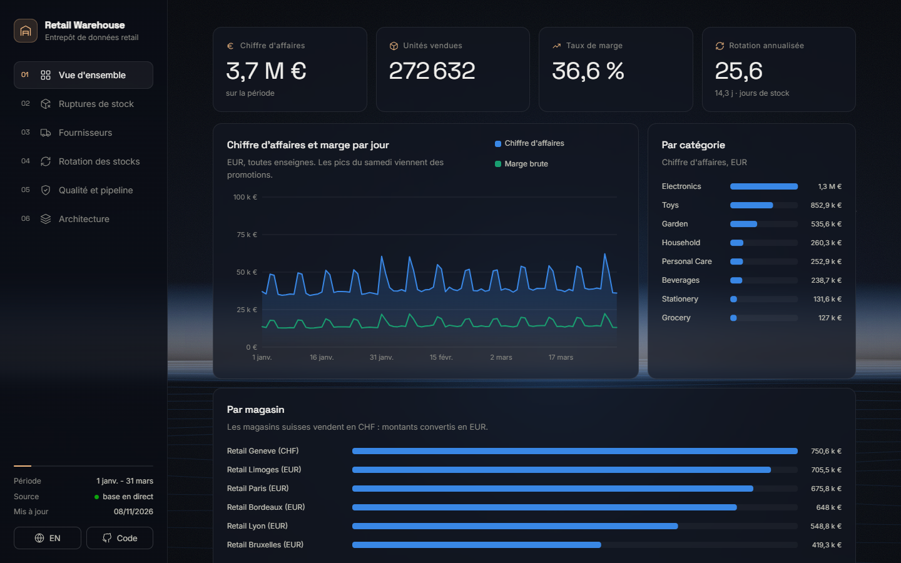
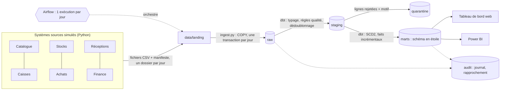
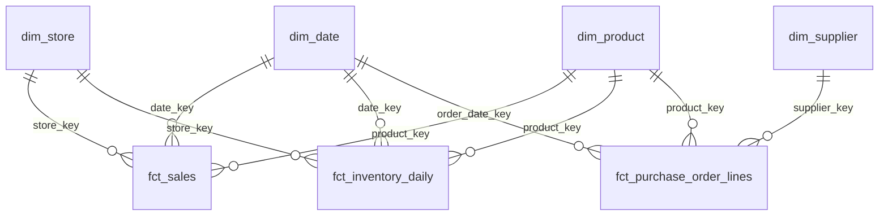
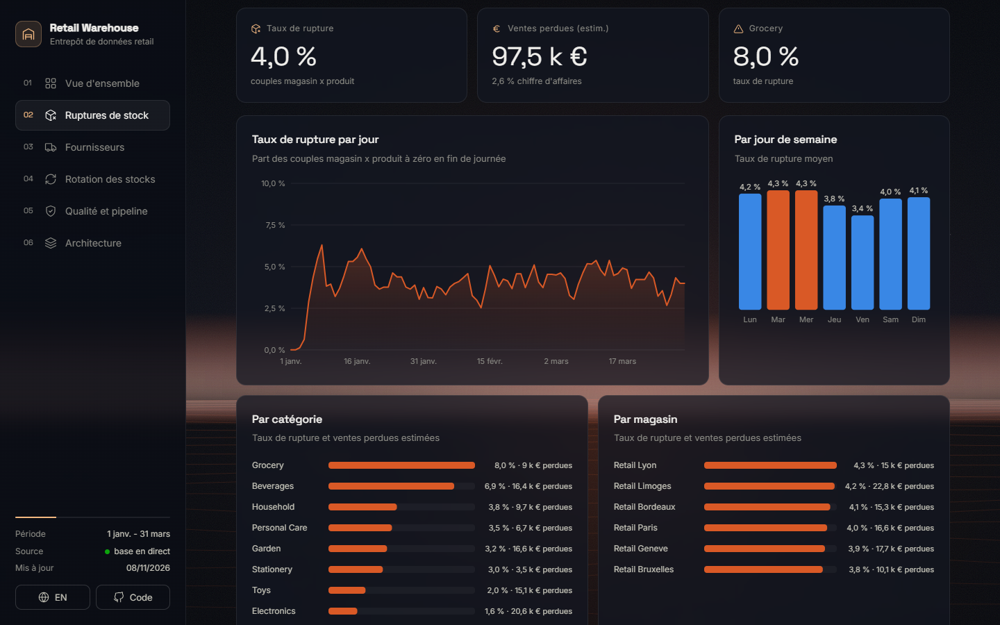

# Entrepôt de données retail : stocks et chaîne d'approvisionnement

[](README.md) [](README.en.md)

[](https://github.com/cheugs/Retail-Inventory-or-and-Supply-Chain-Warehouse/actions/workflows/ci.yml)       

Projet étudiant de data engineering : un **entrepôt de données en schéma en étoile** qui réunit les
**commandes fournisseurs**, le **catalogue produits**, les **livraisons**, les **stocks** et les **ventes**
d'une chaîne de magasins simulée, pour répondre à trois questions : **où manque-t-il du stock**,
**quels fournisseurs tiennent leurs promesses**, et **à quelle vitesse le stock tourne-t-il**.

> Toutes les données sont **synthétiques** : l'entreprise, les magasins, les produits et les
> fournisseurs sont inventés. Le projet montre une démarche d'ingénierie des données ; il ne
> prétend pas décrire une entreprise réelle.

**Démo en ligne :** le tableau de bord se publie gratuitement comme site statique (voir
[docs/DEPLOIEMENT.md](docs/DEPLOIEMENT.md)). La chaîne complète tourne en local avec Docker (section 13).

**Auteure :** Chengho Fongang Marie Louise



**Sommaire :**
[1. Présentation](#1-présentation-du-projet) ·
[2. Contexte](#2-contexte-métier-et-mission) ·
[3. Objectifs](#3-objectifs-du-projet) ·
[4. Architecture](#4-architecture-du-système) ·
[5. Modèle de données](#5-modèle-de-données-et-schéma-des-sources) ·
[6. Défis](#6-défis-techniques-et-solutions) ·
[7. Traitement](#7-traitement-des-données-et-logique-métier) ·
[8. Choix](#8-choix-techniques-et-compromis) ·
[9. Résultats](#9-résultats-et-tests-de-performance) ·
[10. Tableau de bord](#10-tableau-de-bord-et-supervision) ·
[11. Tests](#11-tests-et-fiabilité) ·
[12. Technologies](#12-technologies-utilisées) ·
[13. Installation](#13-installation-et-exécution) ·
[14. Limites](#14-limites-et-améliorations-possibles) ·
[15. Compétences](#15-compétences-démontrées)

---

## 1. Présentation du projet

Un script Python simule les systèmes d'une petite chaîne de **6 magasins** (France, Belgique et Suisse,
donc deux devises : EUR et CHF), **150 produits** et **12 fournisseurs** pendant **90 jours**. Chaque jour,
ces "systèmes sources" déposent leurs fichiers : ventes de caisse, inventaire de fin de journée,
commandes fournisseurs, réceptions, changements du catalogue, taux de change, et un **manifeste** avec
les totaux de contrôle.

**Airflow** charge chaque jour ces fichiers dans PostgreSQL (couche `raw`), lance **dbt** qui nettoie,
vérifie et transforme les données en **schéma en étoile** (3 tables de faits, 4 dimensions dont une
**SCD type 2**), exécute les tests, puis **rapproche** l'entrepôt avec les totaux de la source. Un
tableau de bord web présente les ruptures de stock, la performance des fournisseurs et la rotation
des stocks.

**En bref :**
- **Lancement :** `docker compose up -d --build` (ou `python -m retail_pipeline.run all` sans Airflow)
- **Ce que le projet démontre :** modélisation dimensionnelle, dimensions à évolution lente (SCD 1 et 2),
  transformations incrémentales, données en retard et en avance, isolement des données invalides,
  dédoublonnage, rapprochement avec les totaux de la source, rejeu de l'historique
- **Volume de la démo :** environ 161 000 lignes de vente brutes, 77 000 relevés de stock, 4 500 lignes de commande
- **Testé :** 17 tests unitaires, 17 tests d'intégration et de bout en bout, 48 tests dbt, 14 contrôles de rapprochement, CI GitHub Actions
- **Checklist :** chaque critère d'acceptation est relié à sa preuve dans [docs/CHECKLIST.md](docs/CHECKLIST.md)

## 2. Contexte métier et mission

Dans une enseigne de distribution, les données utiles sont éparpillées : la caisse connaît les ventes,
le logiciel de stock connaît les quantités en rayon, les achats connaissent les commandes, l'entrepôt
connaît les réceptions, et le catalogue change de prix en cours de route. Pour savoir **pourquoi un
rayon est vide**, il faut croiser tout cela.

Ces données sont aussi imparfaites : une caisse renvoie un fichier deux fois, une vente arrive deux
jours plus tard, un nouveau produit est vendu avant d'apparaître dans le catalogue, un changement de
prix est transmis en retard, une colonne apparaît dans un fichier.

**Mission :** construire un entrepôt **fiable** où chaque chiffre peut être expliqué : chaque vente est
comptée une seule fois, à la bonne date, avec le prix et le coût valables à ce moment-là ; les lignes
invalides sont mises de côté avec leur motif ; et les totaux de l'entrepôt sont rapprochés des totaux
de la source.

## 3. Objectifs du projet

1. Simuler des sources réalistes, avec des problèmes de qualité volontaires.
2. Charger les fichiers de façon **idempotente** (relancer un jour ne crée pas de doublon) et **atomique** (un jour entier ou rien).
3. Construire un **schéma en étoile** : faits de ventes, de stock et de commandes ; dimensions produit, magasin, fournisseur, date.
4. Historiser le catalogue produit en **SCD type 2** (prix, coût, fournisseur) et les magasins et fournisseurs en **SCD type 1**.
5. Gérer les **données en retard** et les **faits arrivés avant leur dimension**.
6. **Rapprocher** l'entrepôt avec les totaux de contrôle de la source et prouver que rien ne se perd.
7. Produire trois analyses : **ruptures de stock**, **performance fournisseurs**, **rotation des stocks**.
8. Orchestrer avec **Airflow**, tester automatiquement, mesurer les performances jusqu'à **1 million** de lignes.

## 4. Architecture du système



| Composant | Rôle |
|---|---|
| `retail_pipeline/generate.py` | Simule l'activité jour par jour et écrit les fichiers des systèmes sources |
| `retail_pipeline/ingest.py` | Charge un jour de fichiers dans `raw` (COPY), vérifie le schéma, enregistre le manifeste |
| `dbt/` | Transforme `raw` en `staging`, `quarantine` et `marts` ; contient les tests de données |
| `retail_pipeline/reconcile.py` | Compare l'entrepôt aux totaux de la source, écrit `audit.reconciliation` |
| `airflow/dags/retail_warehouse_daily.py` | Orchestration quotidienne avec relances automatiques |
| `dashboard/` | API FastAPI (données en direct) et site statique (données exportées en JSON) |
| `benchmarks/run_benchmark.py` | Mesure les temps sur 10 000, 100 000 et 1 000 000 de lignes de vente |

**Schémas PostgreSQL :** `raw` (texte brut, tel que reçu) · `staging` (typé et vérifié) · `quarantine`
(rejets avec motif) · `marts` (schéma en étoile et analyses) · `audit` (journal de chargement, étapes
du pipeline, rapprochement).

## 5. Modèle de données et schéma des sources

### Schéma en étoile



| Table | Type | Grain (une ligne =) | Chargement |
|---|---|---|---|
| `fct_sales` | Fait transactionnel | une ligne de ticket de caisse | incrémental (`delete+insert` sur `sale_line_id`) |
| `fct_inventory_daily` | Fait photo périodique | un magasin x un produit x un jour | incrémental |
| `fct_purchase_order_lines` | Fait accumulatif | une ligne de commande fournisseur (commandée, promise, livrée) | reconstruit à chaque run |
| `dim_product` | Dimension SCD type 2 | une **version** d'un produit (`valid_from`, `valid_to`, `is_current`) | reconstruit depuis tout l'historique |
| `dim_store`, `dim_supplier` | Dimensions SCD type 1 | un magasin, un fournisseur (valeurs écrasées) | reconstruit |
| `dim_date` | Calendrier | un jour | généré |

Tables d'analyse (`marts`) : `mart_daily_sales`, `mart_stockouts_daily`, `mart_supplier_performance_monthly`,
`mart_inventory_turnover_monthly`, `mart_product_inventory_health`, `mart_anomaly_indicators`.

### Fichiers sources (un dossier par jour)

| Fichier | Contenu | Problèmes injectés volontairement |
|---|---|---|
| `sales.csv` | `sale_line_id, receipt_id, store_id, product_id, sold_at, quantity, unit_price, discount_amount, currency` (+ `channel` à partir du jour 45, + `loyalty_card` à partir du jour 60) | 2 % en retard de 1 à 2 jours, 0,5 % de doublons, 0,3 % de valeurs invalides, nouvelles colonnes |
| `inventory.csv` | stock de fin de journée par magasin et produit | fichier d'un magasin parfois livré un jour plus tard |
| `products.csv` | changements du catalogue (`updated_at`) | nouveaux produits transmis un jour après leurs premières ventes, changements de prix transmis 2 jours en retard |
| `purchase_orders.csv`, `deliveries.csv` | commandes et réceptions | livraisons en retard, partielles, en plusieurs fois, quantités négatives |
| `stores.csv`, `suppliers.csv`, `fx_rates.csv` | référentiels et taux EUR/CHF | changement de responsable de magasin, de nom de fournisseur (SCD 1) |
| `_manifest.json` | nombre de lignes et sommes de contrôle par fichier | sert au rapprochement |

## 6. Défis techniques et solutions

| Défi | Solution |
|---|---|
| **Une valeur mal formée ne doit pas bloquer le chargement** | La couche `raw` stocke tout en texte. Le typage se fait dans dbt avec une macro `try_cast` (`pg_input_is_valid` sur PostgreSQL 16, `try_cast` sur Snowflake) qui renvoie NULL au lieu d'échouer. |
| **Isoler les lignes invalides sans rien perdre** | Chaque modèle `stg_*_checked` calcule un `rejection_reason`. Les lignes valides vont dans les faits, les autres dans `quarantine.*` avec leur motif. Un test vérifie que raw = faits + quarantaine. |
| **Doublons** (même ligne envoyée deux fois) | `row_number()` par identifiant métier sur toutes les lignes reçues : seule la première occurrence est gardée, les autres partent en quarantaine (`duplicate_sale_line_id`). |
| **Ventes arrivées en retard** | Les faits incrémentaux traitent les lignes chargées depuis le dernier run (`_loaded_at`), quelle que soit leur date de vente : une vente du lundi reçue le mercredi est rangée au lundi. |
| **Ventes d'un produit pas encore dans le catalogue** (fait en avance) | La vente est rattachée au membre "produit inconnu" (`product_key = '-1'`) et retraitée à chaque run jusqu'à l'arrivée du produit. |
| **Changement de prix transmis en retard** | L'historique SCD2 est reconstruit depuis toutes les lignes du catalogue, triées par `updated_at` ; les ventes des produits modifiés depuis le dernier run sont retraitées pour pointer vers la bonne version. |
| **Relancer un jour ou reprendre après une panne** | Un jour = une transaction : suppression puis insertion du lot. Une panne au milieu annule tout le lot ; la relance le recharge entièrement. |
| **Nouvelles colonnes dans les fichiers** | Colonne optionnelle absente = NULL ; colonne inconnue ignorée et notée dans `audit.load_log` ; colonne obligatoire absente = arrêt avec une erreur claire. |
| **Deux devises** | Montants convertis en EUR avec le taux du jour de la vente. |

## 7. Traitement des données et logique métier

**Ruptures de stock.** Un produit est en rupture dans un magasin quand son stock de fin de journée vaut
0. Taux de rupture = jours magasin x produit à 0 / total des jours magasin x produit. Les **ventes
perdues** sont une estimation : pour chaque jour de rupture, on compte la vente moyenne du produit
dans ce magasin les jours où il était disponible.

**Performance fournisseurs.** Chaque ligne de commande garde ses étapes : date de commande, date
promise, première et dernière livraison, quantités commandées et reçues.
- *A l'heure* : première livraison au plus tard à la date promise.
- *En totalité* : quantité reçue >= quantité commandée.
- *OTIF* (On Time In Full) : les deux à la fois, avec la dernière livraison au plus tard à la date promise.
- *Taux de service* : unités reçues / unités commandées.
- Seules les lignes **évaluables** sont comptées (déjà livrées ou dont la date promise est passée),
  pour ne pas pénaliser un fournisseur pour une commande pas encore due.

**Rotation des stocks.** Rotation = coût des marchandises vendues / valeur moyenne du stock, les deux
au **coût** (le coût valable au moment de la vente, grâce au SCD2). Elle est **annualisée**
(x 365 / nombre de jours) pour comparer des périodes de longueur différente. Jours de stock = nombre
de jours / rotation.

**Indicateurs d'anomalie simulés.** Deux règles simples, écrites dans la colonne `rule` :
baisse de stock inexpliquée (stock < stock de la veille + reçu - vendu - 2) et prix de caisse
éloigné de plus de 40 % du prix catalogue. Ce sont des **pistes à vérifier**, pas des preuves de vol
ou de fraude.

**Rapprochement** (`reconcile.py`, 14 contrôles enregistrés dans `audit.reconciliation`) :
1. *Complétude* : lignes et sommes dans `raw` = lignes et sommes du manifeste, pour chaque jour et chaque fichier.
2. *Conservation* : lignes et unités brutes = faits + quarantaine (rien ne disparaît, rien n'est compté deux fois).
3. *Agrégation* : chiffre d'affaires de `mart_daily_sales` = chiffre d'affaires de `fct_sales`.

Si un contrôle échoue, l'étape lève une erreur et la tâche Airflow passe en rouge.

## 8. Choix techniques et compromis

| Choix | Pourquoi | Compromis |
|---|---|---|
| **PostgreSQL** comme entrepôt local, **Snowflake** en cible optionnelle | Gratuit, reproductible avec Docker ; les modèles n'utilisent que des macros multi-bases (`adapter.dispatch`) | La cible Snowflake est configurée (`profiles.yml`) mais pas testée en CI (il faut un compte payant) |
| SCD2 **reconstruit en SQL** à partir de tout l'historique, plutôt qu'un `dbt snapshot` | Le résultat ne dépend pas de l'ordre ni de la date des runs : un changement reçu en retard se range au bon endroit, et un rejeu complet donne le même résultat | Il faut garder tout l'historique du catalogue dans `raw` (petit volume ici) |
| Faits en **`delete+insert`** sur la clé métier | Fonctionne sur PostgreSQL et Snowflake ; une relance remplace les lignes au lieu de les doubler | Un peu plus lent qu'un simple ajout |
| Couche `raw` **en texte** | Aucune valeur ne fait échouer le chargement ; la ligne brute reste visible en quarantaine | Le typage est fait plus tard, dans dbt |
| Un jour = **une transaction** | Pas de jour à moitié chargé | Un très gros jour garde la transaction ouverte plus longtemps |
| Faits de commandes **reconstruits** à chaque run | Un snapshot accumulatif change à chaque livraison ; le reconstruire est simple et sûr | Deviendrait coûteux avec des millions de commandes |
| PostgreSQL avec **`wal_level=minimal`** | Les tables reconstruites par dbt ne passent plus par le journal WAL : `dbt build` 6 fois plus rapide (section 9) | Pas de réplication ni de restauration à un instant précis |
| Tableau de bord **site statique + JSON** pour la démo en ligne | Hébergement gratuit qui ne s'endort pas, aucune base à exposer sur Internet | Les chiffres en ligne sont ceux du dernier export |

**Garanties de livraison.** Le chargement est "au moins une fois" (un jour peut être relancé), mais le
**résultat** est "exactement une fois" : suppression puis insertion par lot dans `raw`, dédoublonnage
par identifiant dans `staging`, `delete+insert` sur la clé dans les faits. C'est testé
(`test_reloading_a_day_is_idempotent`, `test_duplicates_do_not_inflate_amounts`,
`test_crash_during_a_batch_rolls_back_everything`).

## 9. Résultats et tests de performance

### Résultats métier (jeu de démo, 90 jours)

| Indicateur | Valeur |
|---|---|
| Chiffre d'affaires | 3,75 M EUR, marge brute 36,6 % |
| Taux de rupture | 4,0 % des jours magasin x produit ; ventes perdues estimées à 97 500 EUR (2,6 % du CA) |
| Catégories les plus touchées | Epicerie (8,0 %) et Boissons (6,9 %) : faible stock de sécurité et forte demande |
| OTIF fournisseurs | 65,7 % en moyenne, de 47,4 % (SUP09) à 91,3 % (SUP07) ; taux de service 96,4 % |
| Rotation annualisée | 25,6, soit 14,3 jours de stock ; de 5,7 jours (Boissons) à 17,4 jours (Electronique) |

La lecture croisée est intéressante : les catégories qui tournent le plus vite sont aussi celles qui
manquent le plus souvent. Les fournisseurs en retard (SUP09, SUP12, SUP05) alimentent les ruptures.

### Qualité des données (jeu de démo)

| Contrôle | Résultat |
|---|---|
| Lignes isolées en quarantaine | 1 237 (dont 777 doublons), toutes avec leur motif |
| Ventes arrivées en retard | 3 134 lignes, toutes rangées à leur vraie date |
| Ventes reçues avant leur produit | 44 lignes sur 5 produits, toutes rattachées ensuite (0 restant en "inconnu") |
| Versions de produits (SCD2) | 22 nouvelles versions (changements de prix ou de fournisseur) |
| Rapprochement | 14 contrôles sur 14 réussis |

### Performance

Mesuré avec `python -m benchmarks.run_benchmark` (base vide, génération, chargement de tous les jours,
`dbt build` complet avec les 48 tests, rapprochement). Ordinateur portable Windows 11, 12 threads,
PostgreSQL 16 dans Docker Desktop. Détail : [benchmarks/results.md](benchmarks/results.md).

| Taille | Lignes de vente | Lignes sources (tous fichiers) | Ingestion | dbt build | Rapprochement | Total | Lignes/s de bout en bout | Rapprochement |
|---|---:|---:|---:|---:|---:|---:|---:|---|
| 10k | 12 483 | 21 294 | 27,7 s | 18,1 s | 0,2 s | 46 s | 463 | 14/14 réussis |
| 100k | 101 833 | 160 497 | 39,1 s | 47,5 s | 2,5 s | 89 s | 1 800 | 14/14 réussis |
| 1M | 1 026 066 | 1 629 463 | 125,2 s | 383,4 s | 4,3 s | 8 min 33 s | 3 177 | 14/14 réussis |

A 1 million de lignes, la base occupe 896 Mo et le conteneur PostgreSQL environ 840 Mo de mémoire.

**Goulots d'étranglement trouvés et corrigés :**

1. **Ecriture du journal WAL.** Au premier essai, le `dbt build` du plus petit jeu prenait 107 s et
   `pg_stat_activity` montrait toutes les requêtes en attente `WALWrite`. Chaque table reconstruite
   par dbt était d'abord écrite dans le journal de PostgreSQL, sur un disque Docker partagé avec
   d'autres conteneurs. L'entrepôt n'a pas de réplica : `wal_level=minimal` (dans
   `docker-compose.yml`) évite ce journal pour les tables créées dans une transaction.
   Résultat : `dbt build` à 10k passe de 107 s à 18 s.
2. **Dédoublonnage calculé deux fois.** A 1M, `fct_sales` (388 s) et `rejected_sales` (222 s)
   recalculaient la même vue de staging, qui dédoublonne toutes les ventes brutes. Elle est maintenant
   matérialisée une seule fois en table : `fct_sales` passe à 86 s et le total de 13 min 21 s à 8 min 33 s.

**Ce qui reste lent :** `int_store_product_daily` (166 s à 1M : jointures ventes, stock, réceptions et
fonctions de fenêtre sur 1,5 million de lignes magasin x produit x jour) ; à l'ingestion, un coût fixe
par jour (connexion, transaction, journal d'audit) qui domine sur les petits volumes.

**Limite de la mesure :** les temps varient beaucoup d'un essai à l'autre (jusqu'à x2) car le disque
de Docker Desktop était partagé avec les conteneurs d'autres projets en cours d'exécution. Les
lignes 10k et 100k ont été mesurées avant la correction n° 2.

## 10. Tableau de bord et supervision

Le tableau de bord ([dashboard/static](dashboard/static)) est organisé en chapitres, avec une barre
latérale de navigation : **Vue d'ensemble**, **Ruptures de stock**, **Fournisseurs**, **Rotation des stocks**,
**Qualité et pipeline**, **Architecture**. Il est en français, avec un bouton pour passer en anglais.

- Fond animé (horizon dont la couleur change selon le chapitre et qui réagit à la souris), titres
  révélés au défilement, chiffres qui s'animent, graphiques SVG qui se dessinent, info-bulles au survol.
  Les animations sont coupées si le système demande de réduire les mouvements.
- Graphiques faits à la main en SVG (pas de bibliothèque), couleurs choisies pour rester lisibles
  par les personnes daltoniennes ; les statuts ont toujours une icône et un texte.
- En local, la page lit l'API FastAPI (`/api/snapshot`, données en direct). En ligne, elle lit
  `data/snapshot.json`. La barre latérale indique la source.



**Supervision :**
- `audit.load_log` : chaque fichier chargé (lignes, colonnes inconnues, statut).
- `audit.pipeline_runs` : chaque étape (durée, lignes, statut, message d'erreur).
- `audit.reconciliation` : chaque contrôle (attendu, obtenu, écart, statut).
- Airflow (http://localhost:8080) : état de chaque jour, relances, logs.
- La page "Qualité et pipeline" du tableau de bord résume ces tables.

## 11. Tests et fiabilité

| Niveau | Contenu | Commande |
|---|---|---|
| Tests unitaires (17) | Générateur (valeurs réalistes, ids uniques, déterminisme, problèmes injectés), contrôle du schéma des fichiers, structure du DAG, absence de secrets | `pytest tests/unit` |
| Tests dbt (48) | Clés uniques et non nulles, relations faits -> dimensions, valeurs acceptées, SCD2 sans chevauchement, une seule version courante, raw = faits + quarantaine, marts = faits, cohérence des montants | `dbt build` |
| Tests d'intégration et de bout en bout (17) | Sur une vraie base : idempotence, panne au milieu d'un lot, colonne obligatoire absente, vente en retard, produit arrivé après ses ventes, doublon, changement de prix en retard, évolution de schéma, conversion de devises, rejeu complet identique, chiffres du tableau de bord = base | `pytest -m integration` |
| Rapprochement (14 contrôles) | Source = entrepôt, à chaque exécution | `python -m retail_pipeline.run reconcile` |
| CI | GitHub Actions avec PostgreSQL : tests unitaires, `dbt parse`, tests d'intégration, exécution complète sur un petit jeu | à chaque push |

## 12. Technologies utilisées

| Outil | Utilisation |
|---|---|
| Python 3.12 (numpy, pandas, psycopg 3) | Simulation des sources, ingestion par COPY, rapprochement, export |
| SQL / PostgreSQL 16 | Entrepôt (raw, staging, marts, quarantine, audit) |
| dbt 1.9 | Transformations, SCD2, modèles incrémentaux, tests, documentation |
| Airflow 2.10 | Orchestration quotidienne, rattrapage (`catchup`), relances |
| Snowflake | Cible dbt optionnelle (macros multi-bases) |
| Power BI | Lecture directe du schéma `marts` (guide : [docs/POWERBI.md](docs/POWERBI.md)) |
| FastAPI, HTML / CSS / JavaScript | Tableau de bord |
| Docker Compose, GitHub Actions, pytest | Reproductibilité, intégration continue, tests |

## 13. Installation et exécution

**Prérequis :** Docker Desktop et Git. Python 3.12 pour la version sans Airflow et pour les tests.

```bash
git clone https://github.com/cheugs/Retail-Inventory-or-and-Supply-Chain-Warehouse.git
cd Retail-Inventory-or-and-Supply-Chain-Warehouse
cp .env.example .env          # puis changer les mots de passe
```

**Option A : chaîne complète avec Airflow**

```bash
docker compose up -d --build
```

- Le service `generator` écrit les fichiers sources dans `data/landing` (une seule fois).
- Airflow (http://localhost:8080, identifiants du `.env`) exécute le DAG `retail_warehouse_daily` pour
  chacun des 90 jours, dans l'ordre. Sur un ordinateur portable, un jour prend 2 à 4 minutes
  (dont environ 2 minutes de `dbt build`) : le rattrapage complet dure donc plusieurs heures.
  Pour voir rapidement le résultat, utiliser l'option B.
- Tableau de bord en direct : http://localhost:8000

**Option B : sans Airflow (plus rapide, environ 3 minutes)**

```bash
docker compose up -d postgres
pip install -r requirements-dev.txt
python -m retail_pipeline.run all
python -m uvicorn dashboard.app:app --port 8000
```

**Autres commandes utiles**

```bash
python -m retail_pipeline.run ingest --date 2026-02-10   # recharger un jour
python -m retail_pipeline.run replay                     # reconstruire tout l'entrepôt depuis raw
pytest tests/unit                                        # tests unitaires
pytest -m integration                                    # tests d'intégration (base retail_test)
python -m benchmarks.run_benchmark                       # benchmark 10k / 100k / 1M
```

**Mettre le tableau de bord en ligne :** voir [docs/DEPLOIEMENT.md](docs/DEPLOIEMENT.md) (Render,
GitHub Pages, Netlify ; gratuit).

## 14. Limites et améliorations possibles

- **Données simulées** : les comportements (demande, retards fournisseurs) sont simplifiés ; les chiffres ne décrivent aucune entreprise réelle.
- **Ventes perdues** : estimation simple (moyenne des jours disponibles), sans saisonnalité ni report d'achat vers un autre produit.
- **Snowflake** : configuré mais non testé en CI ; la couche d'ingestion vise PostgreSQL (COPY). Sur Snowflake, on utiliserait un stage et `COPY INTO`.
- **Staging recalculé à chaque run** : le dédoublonnage relit toute la table brute (tables `stg_sales_checked` et `stg_inventory_checked`). A beaucoup plus grande échelle, il faudrait une table d'identifiants déjà vus ou un partitionnement par date.
- **`wal_level=minimal`** : plus rapide, mais pas de réplica ni de restauration à un instant précis. Acceptable ici car tout l'entrepôt se reconstruit depuis `raw` ; en production on garderait `replica` et des sauvegardes.
- **Faits de commandes reconstruits** à chaque run : simple, mais à rendre incrémental avec beaucoup plus de commandes.
- **Pas d'alertes** : les échecs sont visibles dans Airflow et les tables d'audit, mais aucune notification (e-mail, Slack) n'est envoyée.
- **Retours clients** non modélisés (quantités négatives rejetées).
- **Idées** : prévision de la demande pour fixer les stocks de sécurité, alertes de rupture, suivi CPU et mémoire détaillé, documentation dbt publiée (`dbt docs`).

## 15. Compétences démontrées

- **Modélisation dimensionnelle** : choix du grain, faits transactionnels, photo périodique et accumulatifs, clés de substitution, membre inconnu.
- **Dimensions à évolution lente** : SCD type 1 et type 2, recherche de la version valide à une date.
- **Transformations incrémentales** avec dbt et gestion des **données en retard et en avance**.
- **Qualité des données** : règles de validation, quarantaine, dédoublonnage, tests automatiques.
- **Rapprochement** avec les totaux de la source et preuve de non-perte.
- **Orchestration** avec Airflow : planification, rattrapage, relances, idempotence.
- **Mesure de performance** jusqu'à 1 million de lignes et identification des goulots.
- **Analyse métier** retail : ruptures, OTIF, rotation des stocks.
- **Ingénierie** : Docker, CI, configuration externalisée, documentation bilingue.
